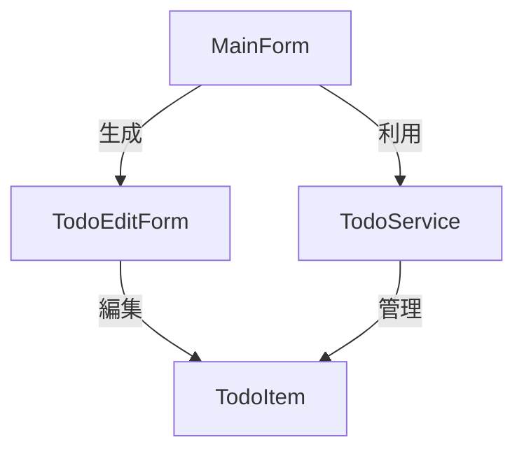

### 【アプリ開発②】コードリーディングのまとめ

対象チケット：#659532【アプリ開発②】既存コードの解析及び開発環境の設定

---

### 1. クラス構造

#### 責務

- `MainForm`：メイン画面のフォームの表示と、フォームイベントに対応した処理の呼び出しを担う
- `TodoEditForm`：編集画面のフォームの表示と、フォームイベントに対応した処理の呼び出しを担う
- `TodoItem`：ToDoアイテムのプロパティを持つ（タイトル、内容、期限日、完了フラグ、IDなど）
- `TodoService`：ToDoアイテムに関する処理を担う（追加、更新、削除、ソート、XML保存、XML読込など）

#### フィールド・プロパティ・メソッド

| クラス名 | フィールド・プロパティ | メソッド |
| --- | --- | --- |
| MainForm | FService (TodoServiceのインスタンス) | MainForm (コンストラクタ) UpdateList (ToDoリスト更新) AddItem (アイテム追加処理の呼び出しと例外処理) EditItem (アイテム編集処理の呼び出し) 各種イベントハンドラ |
| TodoEditForm | Item (単体のアイテム) | TodoEditForm (コンストラクタ) SaveItem (入力をItemに保存する) 各種イベントハンドラ |
| TodoItem | Id (ID) Title (タイトル) Content (内容) DueDate (期限日) IsCompleted (完了フラグ) | ToString (「[完了状態]タイトル」の文字列を返す) |
| TodoService | FItems (全アイテムのリスト) FNextId (次に採番するID) C_FilePath (アイテムリストを保存するXMLパス) | TodoService (コンストラクタ) GetItems (アイテムリストを読取専用で取得) AddOrUpdate (アイテム追加または更新) Add (アイテムをリストに追加) Update (アイテムリストを更新) Export (アイテムリストをXMLで保存) Import (XMLからアイテムリストを読込) SortByDueDate (アイテムリストを期限日順ソート) SortByAddedOrder (アイテムリストを追加順ソート) |

#### クラス間の関係

- `MainForm` -> `TodoEditForm` を生成（編集画面の生成・表示）
- `MainForm` -> `TodoService` を利用（各種ToDo処理メソッドの呼び出し）
- `TodoEditForm` -> `TodoItem` を編集（編集画面の入力内容を保存）
- `TodoService` -> `TodoItem` を管理（全ToDoアイテムをリストで管理、XML保存・読込）

---

### 2. データの流れ

#### ① ToDoの新規追加

1. メイン画面の「追加」ボタンを押すと `ToDoEditForm` が生成・表示される。
1. 編集画面で「保存」ボタンを押すと `SaveItem` メソッドが呼ばれ、入力内容を`Item` に保存、`DialogResult.OK` が返されフォームが閉じる。
1. `AddOrUpdate` メソッドが呼ばれ、条件分岐により `Add` メソッドが呼ばれる。`Item` に `ID` が採番され、`FItems` に追加される。
1. `UpdateList` メソッドが呼ばれ、`FItems` の内容を `FLstItems` に反映する。

#### ② ToDoの編集（編集ボタンは未実装）

1. メイン画面の「編集」ボタンを押すと、選択したアイテムを `Item` にセットして `ToDoEditForm` が生成・表示される。
1. 編集画面で「保存」ボタンを押すと `SaveItem` メソッドが呼ばれ、入力内容を`Item` に保存、`DialogResult.OK` が返されフォームが閉じる。
1. `AddOrUpdate` メソッドが呼ばれ、条件分岐により `Update` メソッドが呼ばれる。`FItems` から同じ `ID` のアイテムを探し、内容を入力内容に更新する。
1. `UpdateList` メソッドが呼ばれ、`FItems` の内容を `FLstItems` に反映する。 

#### ③ ToDoの保存

1. メイン画面メニューの「保存」を押すと `Export` メソッドが呼ばれる。
1. `FItems` の内容を `C_FilePath` で指定したファイルにXML形式で保存する。

#### ④ ToDoの読み込み

1. メイン画面メニューの「読込」を押すと `Import` メソッドが呼ばれる。
1. `C_FilePath` で指定したファイルからXML形式でデータが読み込まれ、`FItems` に反映する。`FNextId` が更新される。

#### ⑤ ToDoのソート（ソート結果が反映されないバグあり）

1. メイン画面メニューの「期限順」/「追加順」を押すと、それぞれ `SortByDueDate` / `SortByAddedOrder` メソッドが呼ばれる。
1. `FItems` の内容が `DueDate` 順 / `ID` 順に並び替えられる。